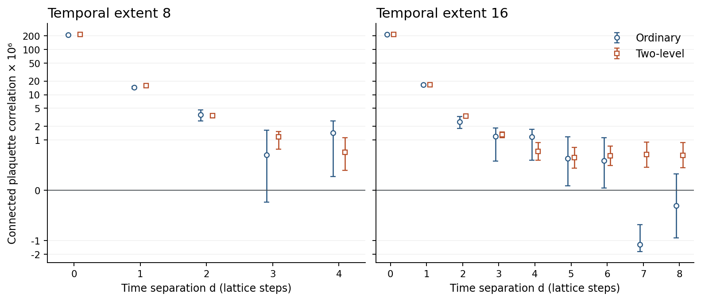

# Connected spatial plaquette correlation at β = 2.3

On a periodic $8^3$ spatial volume the ordinary and two-level estimators both resolve the 01 plaquette correlation through two time steps at temporal extents 8 and 16. Every jointly resolved lag agrees within three paired standard errors. At both extents the first two effective energies differ by more than the prespecified plateau tolerance. The long-lag results depend appreciably on the numerical offset used to center the inner samples. They do not establish a late plateau.



The figure shows the original production estimates with one full-chain standard error. The vertical scale is linear near zero and logarithmic further away. Horizontal offsets separate the symbols at a common integer lag.

| Separation $d$ | $T=8$ ordinary | $T=8$ two-level | $T=16$ ordinary | $T=16$ two-level |
|---:|---:|---:|---:|---:|
| 0 | 210.11 ± 1.55 | 212.85 ± 0.44 | 212.77 ± 1.06 | 212.99 ± 0.29 |
| 1 | 14.48 ± 0.84 | 15.94 ± 0.44 | 16.46 ± 0.66 | 16.64 ± 0.32 |
| 2 | 3.60 ± 0.97 | 3.43 ± 0.37 | 2.54 ± 0.73 | 3.35 ± 0.19 |
| 3 | 0.70 ± 0.94 | 1.18 ± 0.36 | 1.21 ± 0.63 | 1.31 ± 0.18 |
| 4 | 1.45 ± 1.17 | 0.76 ± 0.36 | 1.16 ± 0.56 | 0.78 ± 0.17 |

Multiply every table entry by $10^{-6}$. The data cover all distinct separations through the midpoint of each time circle. Each extent has 16 independently seeded chains, 8,192 outer measurements and equal numbers of hot and cold starts. With the original 0.6 offset, the two-level estimator crosses the three-standard-error signal threshold through $d=3$ at $T=8$ and $d=6$ at $T=16$. The ordinary estimator crosses it through $d=2$ at both extents. Across the common lags the largest two-level extent difference is 1.29 standard errors. These runs do not resolve a finite-time shift. Lean's two-state example demonstrates exactly how a backward contribution can enter. [All lags, contrasts and energies](analysis.tsv) · [Finite trace and vacuum limit](transfer.md)

At $T=8$ the two-level effective energy falls from $2.603\pm0.026$ at $d=1$ to $1.565\pm0.084$ at $d=2$. At $T=16$ the original sequence begins $2.559\pm0.019$, $1.642\pm0.055$, $1.028\pm0.088$. The first change is $-0.917\pm0.066$, and the second is $-0.614\pm0.082$. Neither pair meets the ±0.20 plateau tolerance. At $T=16$ the later energy differences are inconclusive under the same rule. Moving the offset to 0.6022 in an exploratory reanalysis of these same chains preserves the first downward step and leaves $d=4$ below the signal threshold. Sensitivity to that offset limits interpretation of the original energies at $d\ge3$. [Original design](design.md) · [Offset sensitivity](primary-offset-check.tsv)

For the two-level correlators, disjoint halves of the chain IDs and hot-versus-cold groups differ by at most 1.6 standard errors over the two extents. The $T=16$ one-point means of the disjoint halves differ by 2.53 standard errors. Two other diagnostics motivated an independent cohort. At $T=16,d=7$ the original ordinary-minus-two-level difference is $(-1.93\pm0.52)\times10^{-6}$. At the middle slice of a slab the paired inner-minus-outer mean plaquette is $0.000285\pm0.000071$. In finite data, ordinary and conditional samples need not have the same marginal means. Changing a fixed offset by $\delta$ changes the conditional estimator by $\delta(2\widehat{\langle P\rangle}-\widehat{\langle P_1+P_2\rangle}_{\rm selected})$. At $d=7$ changing the offset from 0.6 to 0.6022 moves the two-level result from $0.710\pm0.251$ to $0.103\pm0.071$ in units of $10^{-6}$. The ordinary value is invariant to roundoff. [Independent confirmation design](confirmation-design.md)

The finite-volume Lean identity uses the same orientation, spatial average, time separation and Wilson ensemble. Its positive energy measure describes the fixed-volume vacuum limit. The reported points are finite-periodic-time covariances. Uniform continuum control and extension to all field words remain open. [Derivation and theorem statements](transfer.md)

## What each point measures

Each observation averages one orientation of the fundamental plaquette separately on the two spatial slices, then averages over source times. At each temporal extent the connected correlator subtracts the square of that ensemble's one-point expectation. We estimated that square from products of different chain means. A delete-one-chain jackknife recalculates the subtraction, both correlators and the effective energies in every deletion. All quoted uncertainties are one standard error unless indicated.

Each production chain had 256 warmup sweeps, followed by 512 outer observations separated by two complete Wilson heatbath sweeps. Half started at the identity and half from independently generated hot links. For each outer observation, the two-level measurement made a separate lattice copy, kept spatial links fixed on every fourth time slice, and took 24 conditional sweeps. Distinct slab interiors factor at fixed boundaries. At the nearest lag a single insertion on the boundary is fixed under this conditioning. At zero separation the estimator uses the conditional second moment. The slab origin advances by one on each outer observation. Within-chain autocorrelation is retained in the uncertainty calculation by deleting whole chains. Agreement of starts and disjoint chain groups is an empirical diagnostic of equilibration. [Prespecified design](design.md) · [Multilevel method of Lüscher and Weisz](https://arxiv.org/abs/hep-lat/0108014)

For the finite time circle we use $E_{\rm eff}(d)=\operatorname{acosh}[(C(d-1)+C(d+1))/(2C(d))]$. At the midpoint reflection identifies its two neighbors. Errors there retain the shared fluctuation. An energy requires three resolved entries and a real transform in every jackknife deletion. The decision on adjacent energies uses the paired uncertainty in their difference. The tolerance of 0.20 is in inverse lattice steps.

## Reproduction

Run the first two commands on Spark from a clean Yang checkout. The build verifies the pinned seed compiler, exercises both periodic geometries and compiles the legacy heatbath caller. The run command takes an exclusive FIFO ticket, emits the raw slices to a new file and releases the window. Change the extent and chain ID to reproduce another manifest entry. Chain seeds come from the extent and ID. Even IDs start cold.

```sh
sh scripts/run_plaquette_spectrum.sh build
sh scripts/run_plaquette_spectrum.sh run 8 10 256 512 24
python3 scripts/test_plaquette_spectrum.py
python3 scripts/analyze_plaquette_spectrum.py --production evidence/plaquette_spectrum/raw/*.gz
```

Raw rows contain extent, chain ID, observation index, time slice and three binary64 values encoded as decimal unsigned integers. They store the outer plaquette, the mean inner plaquette and its mean square. The manifest records the window and SHA-256 of each decompressed file. Repeating the first production chain under a separate lease reproduced all bytes (SHA-256 `b1d774b9c2b1ed05514330fdb361a984672aa8cdfa14a7c17a1cbedda0039926`). Count it once. The eight-chain-per-extent pilot used width-two slabs and is archived separately. To reconstruct that executable, apply `git apply --unidiff-zero evidence/plaquette_spectrum/pilot/slab2.patch` in a second checkout, then run the same build. Analyze the pilot by passing `pilot/*.gz` to the analyzer without the production flag. [Run manifest](manifest.tsv) · [Production reduction](analysis.tsv) · [Pilot reduction](pilot/analysis.tsv) · [Build and proof checks](verification.txt)
