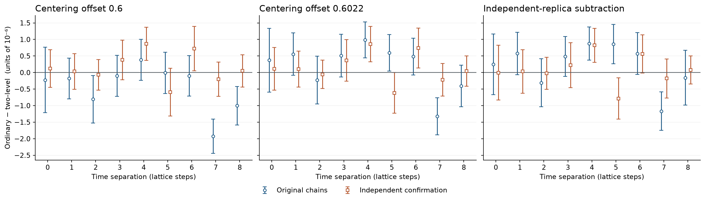
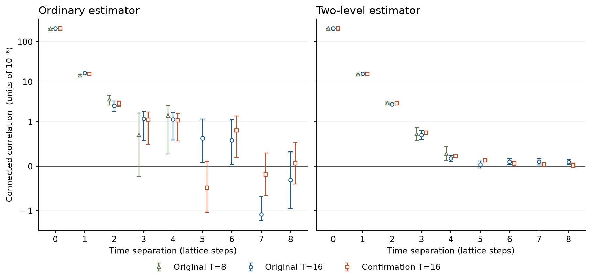

# Did the separation-seven discrepancy reproduce?

It did not. On sixteen new periodic $8^3\times16$ Wilson chains at β = 2.30, ordinary minus two-level at separation seven was less than half a paired standard error at either fixed offset. The offset-independent estimate using all independent-replica pairings gives the same conclusion. The two estimators independently resolve the decay through two steps. One-loop mass fits still vary with the fit window.



Each bar is one standard error from deleting whole independent chains. The first two panels compare estimators on the same outer configurations. The third averages the half-difference formula over all 120 distinct chain pairings, deleting all pairs that contain the omitted chain. All lags travel together. Horizontal offsets separate estimates at the same integer lag.

| $T=16$, ordinary minus two-level at $t=7$, units of $10^{-6}$ | Original chains | Independent confirmation |
|---|---:|---:|
| Original offset 0.6000 | −1.927 ± 0.517 | −0.200 ± 0.517 |
| Confirmation offset 0.6022 | −1.321 ± 0.559 | −0.218 ± 0.495 |
| Eight disjoint replica pairs | −1.156 ± 1.164 | −0.754 ± 0.634 |
| All 120 pairs, whole-chain jackknife | −1.167 ± 0.582 | −0.179 ± 0.591 |

The original fixed-offset result was 3.73 paired standard errors from zero. Allowing for all eight positive lags gives a sign-randomization probability of 0.0108 on those chains under whole-chain sign symmetry. In the confirmation at its prespecified offset, the largest difference was at $t=4$, 1.61 standard errors, with a max-over-lags probability of 0.676. These comparisons keep the two cohorts separate. [Original paired table](../paired-checks.tsv) · [Confirmation paired table](paired-checks.tsv) · [All-pairs table](all-replica-pairs.tsv)

At equilibrium either fixed offset estimates the same connected correlator. On a finite sample the change in the paired difference on moving the offset by $h$ equals $h(\overline{M_s+M_{s+t}}-2\bar P)$, where the first average uses the two selected inner endpoints and the second uses all outer slices. From the recorded endpoint values, the $t=7$ shift in units of $10^{-6}$ is $+0.607\pm0.224$ in the original cohort and $-0.018\pm0.176$ in the confirmation. The original shift accounts for part of its discrepancy. At the center of a slab the earlier inner-minus-outer one-point difference of $0.000285\pm0.000071$ became $0.000048\pm0.000071$. The other interior phases were within 0.36 standard errors of zero. The confirmation hot-minus-cold outer one-point difference was $-0.000248\pm0.000093$. At offset 0.6022 no two-level hot-minus-cold lag exceeded 1.18 standard errors, and the largest disjoint-half contrast was 2.44 at lag zero. [One-point and chain-group checks](analysis.tsv) · [Offset 0.6000](original-offset.tsv)

## Resolved decay and periodic fits



Each panel uses the 0.6022 offset and shows full-chain standard errors. The scale is linear within $\pm10^{-6}$ and logarithmic beyond. In the confirmation, the ordinary signal crosses three standard errors through $t=2$. The two-level signal crosses that threshold through $t=5$ at 0.6022 and through $t=3$ at 0.6000. The all-pairs subtraction also resolves the two-level signal through $t=5$. At $t=5$, the primary two-level estimate is $(0.130\pm0.028)\times 10^{-6}$. At $t=6$ it is $(0.068\pm0.041)\times10^{-6}$. Across the shared lags the original $T=8$ and new $T=16$ two-level estimates at the same offset differ by at most 0.60 combined standard errors. These measurements cannot locate the onset of wraparound.

| Confirmation fit window | Periodic single-energy fit, inverse lattice steps | Correlated $\chi^2$/degrees of freedom |
|---|---:|---:|
| 1–5 | 1.717 ± 0.011 | 70.8/3 |
| 2–5 | 1.389 ± 0.042 | 12.0/2 |
| 3–5 | 1.090 ± 0.091 | 3.80/1 |

The fit includes both $e^{-Et}$ and $e^{-E(T-t)}$. Dropping $t=1$ changes the energy by $-0.329\pm0.042$, and dropping $t=2$ changes it by a further $-0.299\pm0.092$ using paired jackknife differences. The common 1–3 window gives $1.663\pm0.039$ on the original $T=8$ sample and $1.716\pm0.012$ in the confirmation. The latter fit has $\chi^2=69.3$ for one degree of freedom. The data establish initial decay. No window supports a stable plateau across the fit and extent checks. Additional precision at separations four through six would directly test where an effective energy could stabilize. [Original fits at the same offset](../paired-offset-checks.tsv) · [Confirmation fits](paired-checks.tsv) · [Transfer identity and gap interpretation](../transfer.md)

## Data and reproduction

The registered cohort has chain IDs 40–55, eight hot starts and eight cold starts, 1,024 thermalization sweeps, 768 outer observations per chain and 48 inner sweeps per observation. It uses the original pinned executable, observable and four-slice boundaries. The manifest records each FIFO window and the uncompressed SHA-256 of every chain. [Registered design](../confirmation-design.md) · [Manifest](manifest.tsv) · [Raw slice moments](raw/)

From the repository root, use the following commands to rebuild the confirmation tables and both figures.

```sh
d=evidence/plaquette_spectrum
python3 scripts/analyze_plaquette_spectrum.py --confirmation --anchor 0.6022 --marginals "$d"/confirmation/raw/*.gz
python3 scripts/analyze_plaquette_spectrum.py --confirmation --anchor 0.6 --marginals "$d"/confirmation/raw/*.gz
uv run --no-project --with numpy==2.5.5 --with scipy==1.18.1 python scripts/check_plaquette_estimators.py --anchor 0.6022 "$d"/confirmation/raw/*.gz
uv run --no-project --with numpy==2.5.5 --with scipy==1.18.1 python scripts/check_plaquette_estimators.py --all-replica-pairs "$d"/confirmation/raw/*.gz
uv run --no-project --with matplotlib==3.11.2 python scripts/plot_plaquette_checks.py --confirmation "$d"
```
